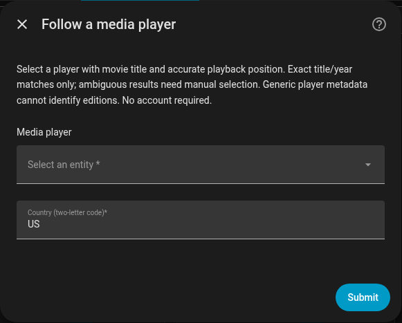

# RunPee for Home Assistant

Bathroom-break windows for the movie you're watching. Attach RunPee to a media player for automatic matching, countdowns, and optional notification automations. It never controls playback.

Requires **Home Assistant 2026.10.0+**. Unofficial integration; no RunPee account or API key needed.

## Installation

### HACS custom repository

Install as a custom repository while default-catalog inclusion is pending.

1. Open **HACS → Custom repositories** and add `https://github.com/ColeMundus/ha-runpee`, type **Integration**.
2. Find **RunPee** in HACS and download the latest release.
3. Restart Home Assistant, then follow [Setup](#setup).

### Manual

Download the ZIP from the [latest release](https://github.com/ColeMundus/ha-runpee/releases/latest), extract it into your Home Assistant configuration directory, then restart Home Assistant.

## Setup

Open **Settings → Devices & services → Add integration → RunPee** and select:

- **Media player:** the entity that exposes the movie's real title and playback position.
- **Country:** a two-letter catalog country code, such as `US`.

Choose a playback entity, not a power/app-only TV entity. **Plex over Google Cast is verified**; other players depend on their metadata. See [player compatibility](docs/usage.md#player-compatibility).

Add one entry per player. Movies match automatically by title and, when available, year. Ambiguous matches require [manual selection](docs/usage.md#manual-selection).

## Entities

| Entity | Meaning |
|---|---|
| Status | Matching/playback state, including `no_match`, `ambiguous`, and `position_unavailable` |
| Movie | Selected movie title and identifying/window metadata |
| Next window | Playback position where the next window starts, in seconds |
| Time until next window | Playback-relative countdown, in seconds |
| Current window remaining | Seconds left in the current window; zero outside a window when timing is valid |
| Upcoming windows | Number of future windows, excluding the current window |
| Pee window active | Binary sensor indicating an active bathroom window |

Countdowns update locally and freeze while paused. Timing requires a valid position/timestamp and 1× playback. Synopses and content-warning alerts are excluded.

## Options and notifications

Use **Configure** to show only recommended windows or adjust the timing offset: positive delays windows, negative advances them. Alternate cuts and pre-roll can affect alignment; check the movie's synchronization cue.

For notifications, use the **`runpee_break`** event and the [automation example](docs/automations.md). Events fire on normal entry into a window, not in advance or as catch-up after a detected seek. See [matching, timing, and actions](docs/usage.md) for details.

## Service and privacy

This uses RunPee's **undocumented web API**, which may change or stop working. Searches send movie titles/IDs and your server's IP to RunPee; requests are cached and paced. Viewing metadata may appear in Home Assistant history and traces. See [privacy details](docs/usage.md#privacy).

Not endorsed by RunPee. [Source code is MIT licensed](LICENSE); RunPee artwork, trademarks, and service content are not. See the [ownership notice](custom_components/runpee/brand/NOTICE.md).

[Contributing](CONTRIBUTING.md) · [Security](SECURITY.md) · [Release checklist](docs/releasing.md)
